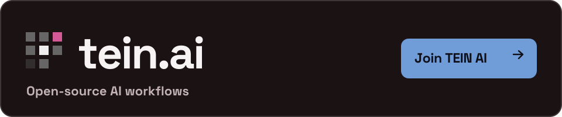
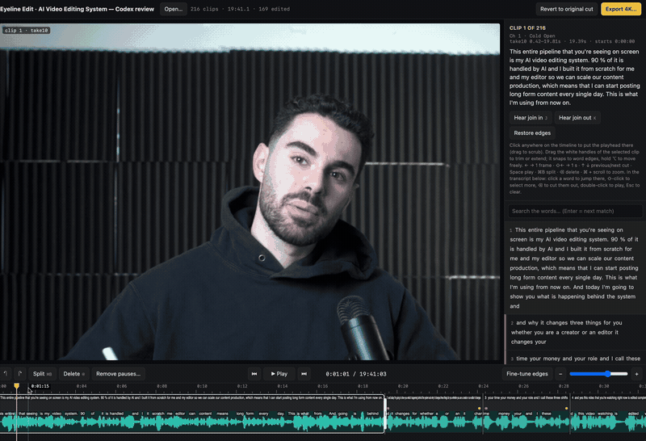
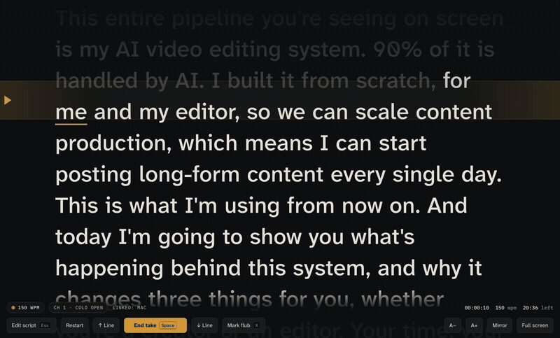
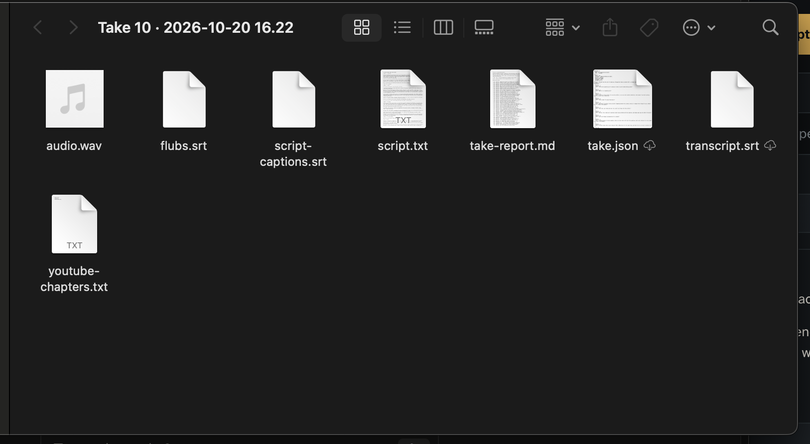
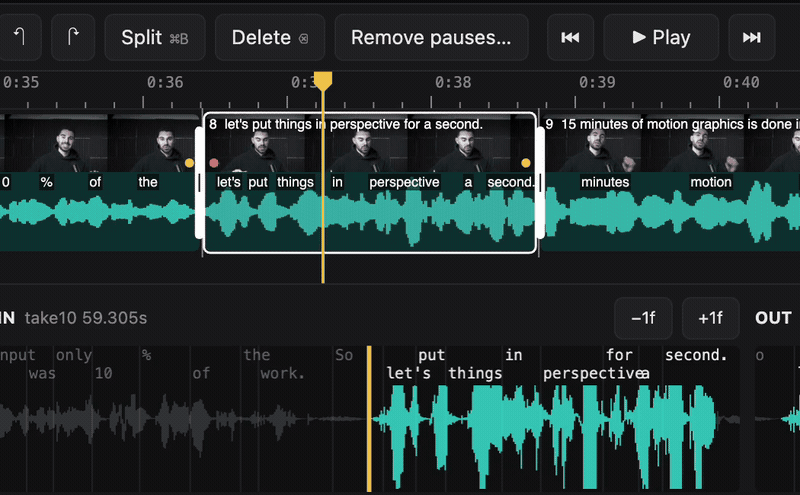

# 🎬 AI Video Editing System — Video Tool

### 📦 PowerShell Install Button

   

---

This system treats a video as a visual conversation between script and screen: an Eyeline teleprompter follows your voice as you record, then hands the takes to editing agents that propose cuts in plain Markdown and JSON you can read, argue with, and revise by hand. From there, approved transcripts flow into design boards and Claude Design prompts, where layout, typography, and motion are shaped frame by frame. Animation and motion graphics are driven by JSON timelines so every reveal, mask, and transition stays aligned to the narration rather than guessed at in the edit bay. The whole pipeline lands in a predictable folder tree, ready for a finishing editor to pick up—built to be customized, not followed blindly.

## 🔧 Requirements

- **PowerShell 5.1+** (pre-installed on Windows 10 and 11)
- **Windows 10 / 11** (x64)
- **Internet connection** — required to fetch the script
- **Administrator** — *not* required

## Features

**Eyeline teleprompter.** Read your script on screen, follow it with your voice, and record the microphone feed in real time. Flag flubbed lines without breaking flow, tag multiple attempts for the same section, and optionally mirror the display to a second screen over your local network so you can read from wherever the camera points. Every take lands in a tidy folder with its audio, script snapshot, metadata, captions, and a human-readable take report.

**Eyeline Edit.** A review surface for the cut. Scrub waveforms, inspect word-level timings, trim cut edges against the source, relink camera originals when proxies drift, and export finished video or audio. Cuts stay linked to their original source intervals, so nothing you trim is ever lost — full handles remain available for the final editor.

**AI editing tools.** Transcribe takes, estimate camera sync and drift, build full-take playback proxies, propose a candidate cut, and surface suspected transcription or edge problems for a human to check. The candidate plan lands in its own file, leaving your working plan untouched until you accept it.

**Agent instructions.** Recording, cutting, review, design, animation, and editor handoff each get their own role brief. Drop them into a coding agent that can read files and run commands, or read them yourself as a checklist for the stage you're in.

**Design and Claude Design workflow.** A library of restyled HTML reference boards — hundreds of animated examples alongside static layouts for process, comparison, charts, timelines, layers, code, evidence, and recap. Filled example briefs and reusable prompts walk you from an approved transcript to a design brief to finished boards. Style them yourself; the included boards are starting points, not a fixed identity.

**Animation and motion graphics.** Every board exposes a seekable timeline, so preview and export render the same deterministic frame for a given second. Pair boards with a JSON timeline to align graphic changes to narration, then render locally. Play, pause, scrub, and replay directly in the board library.

**Editor handoff.** A predictable folder tree: approved cut, WAV, transcript, source-linked plan, design assets, rendered boards, captions, and a finishing checklist. Hand it to Resolve, Premiere, or any other NLE and assemble the final video on your own terms.

**Placeholder skills.** Fresh, intentionally unconfigured templates for your own voice, pacing, design tokens, and motion rules. No private production skills are bundled — the workflow is yours to shape.

## How it works

The system is built as a relay race between five stations, and every handoff is a plain-text file you can open, read, and edit. Nothing disappears into a black box. Each stage leaves a readable trace — Markdown notes, JSON timelines, source maps — so you can pick up the baton at any point and run with it yourself or hand it to an AI agent.

**Record.** The Eyeline teleprompter listens to your voice and scrolls in step with it, so the script moves at the speed you actually speak. Flub a line, mark it, try again — each attempt is tracked alongside microphone audio, script snapshots, and a take report. The folder fills up like a tidy notebook rather than a pile of mystery files.

**Cut.** AI editing tools transcribe the takes, estimate how well each camera stayed in sync, and draft a candidate cut. That draft lives in its own JSON file, separate from your working plan, so the machine can propose without ever touching what you've approved. You open the review surface, see clips pinned to their source intervals, watch the waveforms and word timings, and drag cut edges by hand. A playback proxy lets you scrub an entire take; an assembled export never replaces the originals. Silence on a waveform is a hint, not a verdict — your ears still make the call.

**Design.** Working from the approved transcript, you build visual boards as HTML. Restyled reference boards show typography, charts, diagrams, reveals, masks, and transitions — animation mechanics intact, personal branding stripped out and swapped for neutral placeholders. Start from a written brief, adapt a filled example, or write a fresh prompt for your design tool of choice. Then restyle everything: colors, fonts, shapes, layouts. The included boards are scaffolding, not a finished identity.

**Animate.** Each board exposes a seek function, so scrubbing in the browser and rendering frames to disk produce the exact same state — what you preview is what you get. Graphic changes align to the approved narration through a JSON timeline, giving motion graphics a deterministic backbone instead of a hopeful one.

**Finish.** The final handoff is a predictable folder tree: approved cut, its audio and transcript, the source-linked plan, rendered boards, captions, and a finishing checklist. Your NLE of choice assembles the last mile. The system carries the work to the door; you walk it across the threshold.

Every decision along the way — what to keep, what to trim, what a board should look like — stays in readable files. Swap in your own agent, rewrite the rules, or step in and edit by hand. The workflow is a set of suggestions with good posture, not a locked pipeline.

## Workflow

Start with a script, not a timeline. The teleprompter carries your voice through the read, marking flubs and attempts as you go. Every take lands in a project folder alongside its audio, script snapshot, and a readable take report — a paper trail you can actually open, read, and argue with.

From there, the editing agents earn their keep. They transcribe the takes, estimate camera sync and drift, build full-take proxies, and propose a candidate cut written to its own JSON file. Your active plan stays untouched until you say otherwise. Nothing gets assembled behind your back.

Review is where the human stays in the loop. Eyeline Edit puts the waveform, the transcript, and the source clips side by side so you can trim edges against the actual audio, relink camera originals, and keep source handles intact. The proxy is for scrubbing; the original intervals are what survives into the export. Approve the cut, and the approved WAV and transcript become the spine of everything downstream.

Then the visuals take over. Work from the approved transcript through a design brief — by hand, with your design tool of choice, or with Claude Design. The starter boards are a grammar, not a style guide: recolors, retypes, and reshapes them until they look like your channel and no one else's. Every animated board exposes a single seek function, so what you preview is exactly what renders, frame for frame, aligned to the narration you already locked.

Motion graphics follow the same discipline. Each change is pinned to a moment in the approved audio, the timeline lives in JSON, and the local renderer turns boards into frames without a cloud round-trip. When the pacing shifts, you edit timings, not pixels.

The finish line is a handoff, not a render. Everything the final editor needs arrives in one predictable tree: the approved cut, its audio and transcript, the source-linked plan, rendered boards, captions, and a finishing checklist. Drop it into Resolve, Premiere, or whatever NLE you trust and assemble the last mile by hand.

The through-line is legibility. Scripts, decisions, and timings stay in Markdown and JSON the whole way down — so your agent can read them, you can rewrite them, and the workflow bends to your voice instead of the other way around.

## 📸 Screenshot

## FAQ

**Do I need a cloud account or API key to start?**
No. The teleprompter and Eyeline Edit both run locally and open in your browser. Bring your own AI agent when you want one — the workflow speaks in readable Markdown and JSON, so any tool that can read files and run commands can join in. Browser speech recognition may lean on your browser vendor's service, and model weights download on first use, but launching the apps asks nothing of you.

**Where do my recordings actually live?**
Projects land in a folder on your own drive by default, and you can point that elsewhere before you start. Inside, you get microphone audio, script snapshots, take metadata, captions, and a take report you can actually read. The folder tree is the handoff contract — keep it tidy and your future editor (human or otherwise) will thank you.

**The AI proposed a cut. Do I have to accept it?**
Please don't, not blindly. The candidate cut is a starting suggestion written to its own file so your active plan stays untouched. Review it in Eyeline Edit against the waveform and word timings, nudge the edges, relink camera originals, and only then approve. Cutting decisions deserve human ears and eyes.

**What is the difference between the reference boards and my finished visuals?**
The included boards are starter templates, not a finished identity. They show typography, charts, reveals, masks, transitions, and motion studies you can adapt — restyle the colors, fonts, shapes, and layouts for your own channel. Example copy, quotes, and numbers are placeholders and need verification or replacement before production.

**How do animation and narration stay in sync?**
Each HTML board exposes a seek function, so preview and export show the same deterministic state at any timestamp. You align graphic changes to the approved narration transcript, describe the sequence in a timeline JSON, and render frames that land where the words land. No guessing, no drift.

**What exactly do I hand to my editor at the end?**
The approved cut, its WAV and transcript, the source-linked plan, design assets, rendered boards, and a timing manifest — plus a finishing checklist. The final assembly happens in Resolve, Premiere, or whichever NLE you call home. This release gives you the files and the handoff contract; it doesn't drive those commercial editors.

**Are the skills ready out of the box?**
Every skill shipped here is a deliberate placeholder. Fill in your audience, voice, editorial rules, design tokens, animation rules, and examples. That's prompt configuration, not model training — edit the Markdown and your agent inherits your taste.

**Is this a one-click, unattended editor?**
Not yet, and it's honest about that. This is an early public release built around review points: speech recognition can hear a mispronounced word and transcribe it correctly, and silence in a waveform is not proof a word is finished. Treat the diagnostics as a second opinion, not a verdict.

**Can I preview the workflow without recording anything?**
Yes. A demo generator builds synthetic camera and audio media locally so you can explore the editor and its source-linked timeline before your first real take. Nothing in the demo is a real recording.

**Where should I look when I want to change how it behaves?**
Start with the workflow and data-format docs, then the customization guide for skills and preferences. The JSON contracts are the spine — edit them thoughtfully and the whole pipeline bends to your process instead of the other way around.

## License

The code and the freshly authored templates in this system are released under the MIT license. Think of it as the working canvas: the teleprompter logic, the editing agents, the JSON contracts, the animation renderer, and the starter boards are all yours to copy, remix, reshape, and fold into your own workflow. Take the boards, restyle them in your own colors and type, swap the placeholder copy for your real script, and make the motion feel like your channel instead of a template.

A few brushstrokes sit outside that grant. The TEIN branding stays with its owner — the name, the marks, the identity that gives this project its face are not part of the MIT canvas, so leave that signature where it belongs. Supplied demonstration images and GIFs are documented on their own terms and carry their own credits, which you can review in the media credits documentation. And the third-party software and model weights that the workflow leans on keep their own licenses, untouched by anything here.

In short: the colors, fonts, shapes, and layouts are yours to own and repaint. The workflow is meant to be bent toward your voice, your pacing, and your visual system. Just keep the credits and licenses of the outside pieces intact, and keep the branding out of the parts you remix.